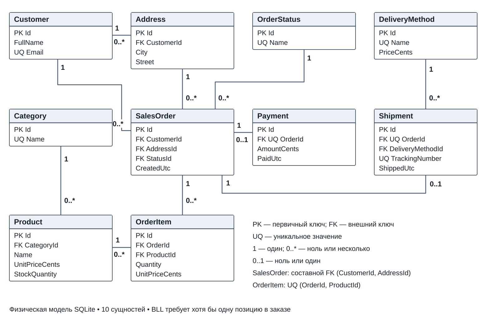

# Лабораторная работа № 1

**Тема:** Разработка структуры проекта информационной системы.  
**Дисциплина:** Разработка кода информационных систем.  
**Обучающийся:** Тишин М. С., группа ВБИо-401рсоб.  
**Преподаватель:** Скопин В. И.

Разработана структура системы управления заказами **OrderFlow**:
ER-модель из 10 сущностей, многослойное C#-решение, рабочий сценарий
создания заказа и база SQLite.

## Материалы

- [Отчёт Word](reports/ЛР01_Тишин_ВБИо-401рсоб.docx)
- [ER-диаграмма](docs/images/er.svg)
- [Диаграмма компонентов](docs/images/components.svg)
- [Модель данных и правила](docs/model.md)
- [Физическая схема SQL](schema/shop.sql) и [начальные данные](schema/seed.sql)
- [Результаты сборки и запусков](evidence)

## Структура решения

| Проект | Назначение | Прямые ссылки на проекты |
|---|---|---|
| `src/OrderFlow.Domain` | 10 моделей предметной области | Нет |
| `src/OrderFlow.DAL` | SQL, репозиторий, транзакции SQLite | Domain |
| `src/OrderFlow.BLL` | Правила оформления заказа и расчёт суммы | Domain, DAL |
| `src/OrderFlow.UI` | Консольный интерфейс и сборка зависимостей | BLL, DAL |
| `tests/OrderFlow.Checks` | Проверки на настоящей временной базе | BLL, DAL |

Во время работы запросы идут по цепочке **UI → BLL → DAL → SQLite**.
Ссылка UI на DAL нужна для создания и инициализации репозитория в `Program.cs`.
Каталог, оформление заказа и чтение его позиций UI вызывает через BLL.
Domain содержит общие модели и не зависит от остальных проектов.
Циклических ссылок нет.

## Модель данных

Таблицы: `Customer`, `Address`, `Category`, `Product`, `OrderStatus`,
`SalesOrder`, `OrderItem`, `Payment`, `DeliveryMethod`, `Shipment`.
Модель C# `Order` соответствует таблице `SalesOrder`.



Связь заказов и товаров многие-ко-многим раскрыта таблицей `OrderItem`.
В позиции хранится цена на момент заказа. Денежные значения представлены
целым числом копеек. Сумма товаров рассчитывается как сумма произведений
количества и сохранённой цены; стоимость доставки в эту сумму не входит.

## Требования и запуск

- .NET SDK 8.0 и доступ к NuGet при первой сборке.
- Python 3 нужен только для дополнительной проверки SQL-схемы.
- Visual Studio 2022 либо настольный VS Code с C# Dev Kit для редактирования.
- SQLite устанавливать отдельно не нужно: пакет `Microsoft.Data.Sqlite` 8.0.31
  включает нужную библиотеку через свои зависимости.

Откройте `OrderFlow.sln`. Команды выполняются из корня репозитория:

```bash
dotnet build OrderFlow.sln --configuration Release
dotnet run --project src/OrderFlow.UI --configuration Release --no-build
```

Программа создаёт `artifacts/orders.db`, выводит каталог и оформляет заказ:
две клавиатуры по 1999 рублей и одну мышь за 1299 рублей.
Сумма товаров — **5297,00 рубля**. Остатки уменьшаются с 10 до 8 и с 15 до 14.
На свежей базе новый заказ получает номер 2; номер 1 занимает начальный пример.

Каждый запуск добавляет заказ в выбранную базу и расходует остатки.
Для повторения исходного примера передайте новое имя файла:

```bash
dotnet run --project src/OrderFlow.UI -c Release -- artifacts/another-demo.db
```

## Проверки

```bash
dotnet run --project tests/OrderFlow.Checks --configuration Release --no-build
python scripts/check_schema.py
```

На Linux и macOS при необходимости используйте `python3`.

Проверены 11 сценариев C#: сохранение и сумма заказа, изменение остатков,
объединение одинаковых товаров, запрет пустого заказа и неверного количества,
проверка владельца адреса, отсутствующих записей и нехватки товара,
откат транзакции и повторная инициализация без сброса данных.
SQL-проверка подтверждает 10 таблиц, целостность связей и отклонение 5
недопустимых записей. Результаты находятся в `evidence`.

GitHub Actions автоматически выполняет сборку, C#-проверки,
проверку SQL-схемы и демонстрацию при `push` и `pull_request`.

## Сохранение в GitHub

В `.vscode/settings.json` включено сохранение файлов редактором через
1 секунду и `git.postCommitCommand: push` для отправки изменений после коммита
в настольном VS Code. Это разные операции: сохранение файла не создаёт коммит.
Выберите изменённые файлы, укажите сообщение и выполните **Commit & Push**.
Веб-редактор github.dev позволяет просматривать структуру и создавать коммиты;
сборка выполняется локально через .NET SDK либо в GitHub Actions.

## Границы лабораторной

Это базовый проект, демонстрирующий разделение ответственности и один сквозной
сценарий. Таблицы оплаты и отгрузки включены в модель и начальные данные.
Платёжный шлюз, авторизация и управление жизненным циклом доставки в эту
лабораторную не входят.

## Документация

- [Структура .NET-решения и ссылки проектов](https://learn.microsoft.com/en-us/dotnet/core/tutorials/libraries)
- [Многослойная архитектура](https://learn.microsoft.com/en-us/dotnet/architecture/modern-web-apps-azure/common-web-application-architectures)
- [Microsoft.Data.Sqlite](https://learn.microsoft.com/en-us/dotnet/standard/data/sqlite/)
- [Внешние ключи SQLite](https://www.sqlite.org/foreignkeys.html)
